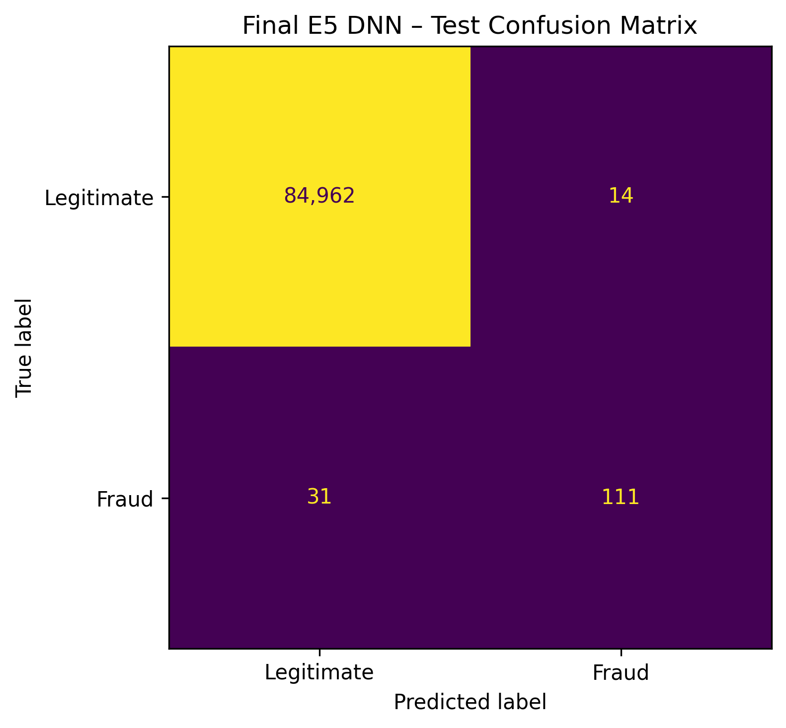

# Open Innovations in Data Science

Three completed academic analyses examine how rare-event classification and image recognition should be evaluated: credit-card fraud detection, Fashion-MNIST classification and cerebral-stroke status classification. The portfolio emphasises controlled experiments, validation-based selection, error analysis and transparent limitations.

Python, TensorFlow/Keras, PyTorch, scikit-learn and XGBoost support the modelling workflows. Saved evidence is separated from newly executed packaging checks. These projects demonstrate data preprocessing, experimental design and evaluation relevant to analyst and applied data-science roles.

## Start here

Read the [results and methodology](docs/RESULTS.md), then inspect the [notebooks](notebooks) and aggregate evidence. [Reproducibility](docs/REPRODUCIBILITY.md) explains execution controls and data acquisition. [Verification](docs/VERIFICATION.md) records what was checked in this portfolio preparation.

| Completed analysis | Selection | Recorded test result |
| --- | --- | --- |
| Credit-card fraud | E5: RobustScaler, batch-normalised 128-64-32 DNN, adaptive learning rate | Precision 0.8880; recall 0.7817; F1 0.8315; PR-AUC 0.8337 |
| Fashion-MNIST | `05_combined_40_seed42`; checkpoint from epoch 36 of 40 | 92.99% accuracy; loss 0.2064; 9,299/10,000 correct |
| Cerebral stroke | Development-selected XGBoost with KNN BMI imputation | ROC-AUC 0.8445; PR-AUC 0.0974; recall 44.6%; precision 8.7% |

Fraud accuracy was 99.947%, but 31 of 142 fraud cases were missed. The minority-class metrics and alert burden are more informative than accuracy alone. Fashion-MNIST's public test set had been observed during earlier pilot work. The stroke analysis classifies recorded status and does not establish future risk or clinical utility.

## Repository map

- `notebooks/`: readable source with all execution disabled by default and embedded outputs removed.
- `Project1/`: aggregate fraud experiment, threshold and error records.
- `Project2/`: five-run validation comparison, saved checkpoints, licensed working dataset and test summary.
- `CW2/results/`: aggregate stroke results and held-out model comparison.
- `requirements/`: recorded historical environments, with unpinned packages disclosed.

A dependency-free inspection is available with `python tools/verify_saved_results.py`. Do not rerun training or final-test scoring just to confirm the table above. Exact training reproduction was not performed during this preparation.

## Scope and attribution

Completed M32366 coursework, BSc (Hons) Data Science and Analytics, University of Portsmouth through Kaplan Singapore. Development involved substantial AI assistance. See [attribution](ATTRIBUTION.md), [third-party notices](THIRD_PARTY_NOTICES.md) and [rights](LICENSE.md). Original reports, raw fraud/stroke datasets and record-level outputs are excluded from the public package.
